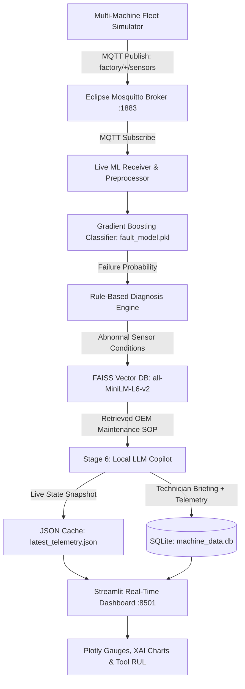

# 🏭 P_311 — Knowledge-Driven IoT Fault Diagnosis Assistant

An end-to-end Industrial IoT (IIoT) predictive maintenance and intelligent fault diagnosis system. Combines real-time MQTT sensor telemetry, Gradient Boosting machine learning, FAISS-based Retrieval-Augmented Generation (RAG), and a Local LLM Copilot with an interactive multi-machine fleet dashboard.

---

## 🏗️ System Architecture



---

## 🚀 Key Features

1. **Multi-Machine IoT Fleet Simulation:**
   - Simulates a 3-machine factory cell:
     - `machine1`: CNC Milling Center (Type M)
     - `machine2`: Heavy Duty Lathe (Type H)
     - `machine3`: High Speed Grinder (Type L)
   - Transmits real-time speed, torque, cutting temperatures, and tool wear over MQTT.

2. **Machine Learning Failure Prediction (Stage 4):**
   - Trained on the 10,000-record AI4I 2020 Predictive Maintenance Dataset.
   - Algorithm: **Gradient Boosting Classifier** (**0.9696 ROC-AUC**).
   - Calibrated Operating Threshold: **0.40** (optimized for failure recall to avoid costly missed downtime).
   - **No Target Leakage:** Failure type columns (TWF, HDF, PWF, OSF, RNF) strictly excluded from training inputs.

3. **Retrieval-Augmented Generation (RAG) (Stage 5):**
   - Dense embeddings generated with `sentence-transformers/all-MiniLM-L6-v2` (384 dimensions).
   - Vector similarity indexing via **FAISS** (`IndexFlatIP`).
   - Dynamically searches maintenance SOPs for identified physical anomalies (High Torque, Thermal Spikes, Spindle Stall, Tool Wear).

4. **Local LLM Technician Copilot (Stage 6):**
   - Multi-backend support: Direct integration with local **Ollama** (`llama3.2:1b`, `phi3`, `mistral`) + zero-latency grounded fallback.
   - Synthesizes telemetry and RAG context into structured technician briefings: Situation Summary, Root-Cause Assessment, and Immediate Action Checklists.
   - **100% Grounded:** Eliminates hallucinations by anchoring explanations strictly in OEM knowledge documents.

5. **Explainable AI & Remaining Useful Life (Stage 8):**
   - **Explainable AI (XAI):** Real-time feature attribution bar chart breaking down which sensor inputs contributed to current risk.
   - **Remaining Useful Life (RUL):** Real-time degradation countdown towards the 150-minute tool replacement limit.

6. **Fleet Health Dashboard (Stage 7):**
   - Real-time dark industrial UI with Plotly speedometer gauges.
   - Fleet switcher dropdown to inspect individual machines.
   - Telemetry audit trail with CSV data export.

---

## 📁 Repository Structure

```text
p311-iot-fault-diagnosis/
│
├── config.py                     # Centralized configuration (MQTT, ML, RAG, thresholds)
├── launch_demo.py                # One-click master launcher script
├── run_system.bat                # Windows double-click launcher
├── requirements.txt              # Core dependency specification
│
├── ai4i_machine_simulator.py     # Multi-machine fleet telemetry publisher (MQTT)
├── ai4i_ml_receiver.py           # Backend: ML inference, diagnosis, RAG & DB logger
├── diagnosis.py                  # Physical sensor rule engine & severity grader
│
├── train_ai4i.py                 # ML model training script on AI4I dataset
├── models/
│   └── fault_model.pkl           # Packaged Gradient Boosting model + threshold
│
├── knowledge_base/
│   └── maintenance_knowledge.txt # Raw OEM maintenance procedures
├── create_vector_db.py           # Embeddings & FAISS index builder
├── rag/
│   ├── maintenance.index         # Serialized FAISS vector index
│   └── documents.pkl             # Document chunk store
├── rag_retriever.py              # Semantic vector search interface
│
├── llm_assistant.py              # Stage 6 Local LLM Copilot & grounded synthesizer
├── dashboard.py                  # Streamlit real-time fleet dashboard (Plotly)
│
├── docs/                         # Official HCLTech BTech Project Documentation
│   ├── 01_Problem_Statement.md
│   ├── 02_Software_Requirements_Specification_SRS.md
│   ├── 03_System_Design_and_Architecture.md
│   ├── 04_Bill_of_Materials_BOM.md
│   ├── 05_Test_Plan_and_Test_Results.md
│   ├── 06_Presentation_Deck_Summary.md
│   ├── 07_Comprehensive_Project_Report.md
│   ├── P_311_Final_Presentation_Deck.pptx  # 16:9 Slide Presentation Deck
│   ├── P_311_Project_Report.docx           # Official Word Project Report
│   └── videos/
│       ├── P_311_Industrial_IoT_Demo.mp4   # Full HD MP4 Video Walkthrough
│       └── P_311_Industrial_IoT_Demo.webm  # High-Definition WebM Recording
│
├── machine_data.db               # SQLite historical telemetry database
├── latest_telemetry.json         # Real-time multi-machine JSON state buffer
├── ai4i2020.csv                  # AI4I 2020 Predictive Maintenance Dataset
├── VIVA_GUIDE.md                 # Complete viva & hackathon Q&A defense cheat sheet
└── README.md                     # Project documentation
```

---

## 🎥 Live System Demo Video
The live system demonstration is available on YouTube and stored locally in the repository:
* 📺 **YouTube Video Walkthrough:** **[https://youtu.be/co-VyIK7CFI](https://youtu.be/co-VyIK7CFI)**
* 🎬 **Full HD MP4 Video:** [docs/videos/P_311_Industrial_IoT_Demo.mp4](docs/videos/P_311_Industrial_IoT_Demo.mp4) (4.2 MB)
* 🌐 **High-Definition WebM:** [docs/videos/P_311_Industrial_IoT_Demo.webm](docs/videos/P_311_Industrial_IoT_Demo.webm) (4.1 MB)
* 🖥️ **Interactive Standalone Showcase:** [docs/DEMO_INTERACTIVE_SHOWCASE.html](docs/DEMO_INTERACTIVE_SHOWCASE.html) *(Double-click to open in any browser)*

**Video Highlights Demonstrated:**
1. Multi-machine real-time telemetry streaming over MQTT.
2. Live Plotly speedometer gauges updating dynamically every 2 seconds.
3. Interactive fault injection (*"Send Fault"* trigger causing immediate alarm transition, probability surge, and XAI attribution updates).
4. Stage 6 Local LLM Copilot briefing synthesizing OEM maintenance standard operating procedures (SOPs).
5. Dynamic multi-machine fleet switching (`machine1` CNC Mill $\rightarrow$ `machine2` Lathe $\rightarrow$ `machine3` Grinder).
6. Tool Remaining Useful Life (RUL) countdown degradation.
7. SQLite audit trail expansion and CSV log export.

---

## 👤 Learner & Mentor Details
* **Student Name:** KUSHAGRA SHAROYA
* **Roll Number:** 2400320100636
* **Project Mentor:** VIKAS MAURYA
* **Program:** HCLTech BTech Project Training Program (Embedded Systems & IoT)
* **Version:** v1.0 | October 2026

---

## ⚡ Quick Start Guide

### Option 1: One-Click Master Launcher (Recommended)
Double-click `run_system.bat` on Windows, or run:
```bash
python launch_demo.py
```
This automatically verifies Mosquitto, starts the ML receiver, launches the fleet simulator, and opens the dashboard in your browser at `http://localhost:8501`.

---

### Option 2: Manual 3-Terminal Execution

#### 🟢 Terminal 1: Mosquitto MQTT Broker
Ensure Mosquitto is running on port 1883:
```bash
mosquitto -c /path/to/mosquitto.conf
```
*(On Windows, Mosquitto runs automatically as a system service).*

#### 🔵 Terminal 2: ML + RAG + LLM Backend Receiver
```bash
python ai4i_ml_receiver.py
```

#### 🟠 Terminal 3: Interactive Dashboard & Simulator
Start the dashboard:
```bash
python -m streamlit run dashboard.py
```
And stream live multi-machine fleet telemetry:
```bash
python ai4i_machine_simulator.py
```

---

## ⚙️ Configuration Reference (`config.py`)

All system parameters can be modified in a single location:
- **MQTT:** Change broker IP/port to switch between local Mosquitto and cloud brokers (HiveMQ Cloud, AWS IoT Core).
- **ML Threshold:** Modify `DECISION_THRESHOLD` (default: `0.40`).
- **Physical Sensor Limits:** Adjust warning and critical thresholds for temperatures, RPM, torque, and tool wear.

---

## 🎓 Viva & Presentation Preparation
Read [VIVA_GUIDE.md](VIVA_GUIDE.md) for detailed explanations of:
- Why Gradient Boosting outperforms LSTMs on tabular telemetry.
- Precision-Recall trade-offs in predictive maintenance.
- Avoiding target leakage in industrial ML datasets.
- Edge vs. Cloud IoT architecture in smart manufacturing.
