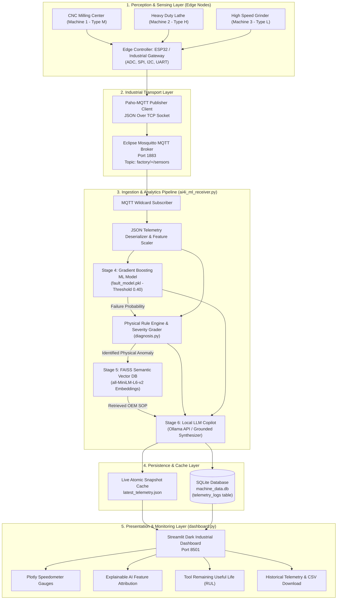
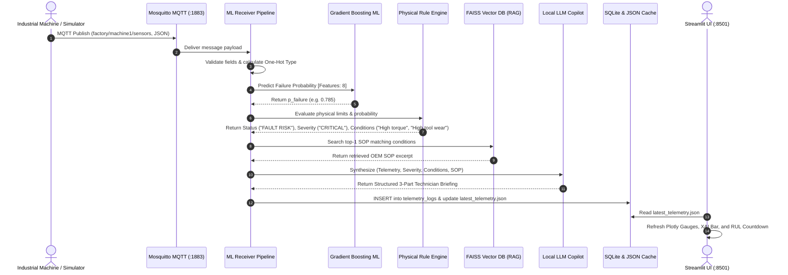

# P_311 — System Design & Architecture Document
## Knowledge-Driven Industrial IoT Fault Diagnosis Assistant

**Student Name:** KUSHAGRA SHAROYA  
**Roll Number:** 2400320100636  
**Mentor Name:** VIKAS MAURYA  
**Document Version:** v1.0 | October 2026  

---

## 1. Architectural Overview

The P_311 Industrial IoT Fault Diagnosis Assistant is designed around an event-driven, decoupled micro-pipeline architecture. It bridges physical edge sensing with modern Edge AI analytics, semantic vector retrieval, and human-in-the-loop decision support.



---

## 2. Hardware Edge Gateway & Circuit Pinout Design

For physical deployment in an industrial shop floor (as specified in HCLTech IoT Project Guidelines), an **ESP32 DevKit v1** micro-controller serves as the physical edge data acquisition gateway.

### 2.1 Hardware Component & GPIO Pin Mapping

| Peripheral / Sensor | Physical Interface | ESP32 GPIO Pin | Signal Type | Measurement Function |
| :--- | :--- | :---: | :---: | :--- |
| **K-Type Thermocouple (MAX6675)** | SPI (MISO / SCK / CS) | GPIO 19, 18, 5 | Digital SPI | Process Cutting Temperature ($300 - 320\text{ K}$) |
| **DHT22 / SHT31 Ambient Sensor** | 1-Wire Digital Bus | GPIO 4 | Digital Serial | Factory Ambient Air Temperature ($295 - 305\text{ K}$) |
| **SCT-013 Non-Invasive Current Sensor** | Analog ADC via burden resistor | GPIO 34 (ADC1_CH6) | Analog (0-3.3V) | Spindle Motor Current $\rightarrow$ Motor Torque ($30 - 80\text{ Nm}$) |
| **Optical Rotary Encoder (E6B2-CWZ)** | High-Speed Pulse Counter (PCNT) | GPIO 16, 17 | Hardware Interrupt | Spindle Rotational Speed ($1000 - 2800\text{ RPM}$) |
| **Tool Wear Cycle Counter** | Digital Contact Input / Memory | GPIO 23 | Digital Input | Cutting Minutes Accumulator ($0 - 250\text{ min}$) |
| **0.96" I2C OLED Display (SSD1306)** | I2C (SDA / SCL) | GPIO 21, 22 | Digital I2C | Local Shop-Floor Machine Health Display |
| **Industrial Warning Buzzer / LED** | General Purpose Output | GPIO 2 | Digital Output (PWM) | Physical Critical Alarm Trigger |

### 2.2 Power Supply & Protection Circuitry
* **Power Conditioning:** Factory 24V DC bus stepped down to 5V DC (3A) using an industrial LM2596 step-down buck converter.
* **Transient Protection:** TVS diodes and optocouplers isolate digital GPIO pins against high-voltage inductive kickback from industrial motor contactors.

---

## 3. End-to-End Runtime Data Flow

The following sequence illustrates the exact execution lifecycle of every telemetry packet:



---

## 4. Database Schema & Data Dictionary

### 4.1 SQLite Table: `telemetry_logs`
Stored in [machine_data.db](file:///e:/HCL%20TRAINING/Knowledge%20Driven%20IOT%20Fault%20Diagnosis%20Assistant/machine_data.db):

```sql
CREATE TABLE IF NOT EXISTS telemetry_logs (
    id                  INTEGER PRIMARY KEY AUTOINCREMENT,
    timestamp           TEXT NOT NULL,
    machine_id          TEXT NOT NULL,
    machine_type        TEXT NOT NULL,
    air_temperature     REAL NOT NULL,
    process_temperature REAL NOT NULL,
    rotational_speed    INTEGER NOT NULL,
    torque              REAL NOT NULL,
    tool_wear           INTEGER NOT NULL,
    failure_probability REAL NOT NULL,
    status              TEXT NOT NULL,
    severity            TEXT NOT NULL,
    conditions          TEXT NOT NULL,
    recommendation      TEXT NOT NULL,
    rag_advice          TEXT,
    llm_briefing        TEXT
);
```

### 4.2 Field Descriptions

| Field | Data Type | Units / Range | Description |
| :--- | :--- | :--- | :--- |
| `id` | `INTEGER` | $1, 2, 3, \dots$ | Primary Key auto-increment. |
| `timestamp` | `TEXT` | `HH:MM:SS` | Machine local packet timestamp. |
| `machine_id` | `TEXT` | `machine1`, `machine2`, `machine3` | Unique fleet identifier. |
| `machine_type` | `TEXT` | `L`, `M`, `H` | Machine quality variant (Low, Medium, Heavy-duty). |
| `air_temperature` | `REAL` | $295.0 - 305.0\text{ K}$ | Factory ambient temperature. |
| `process_temperature` | `REAL` | $305.0 - 315.0\text{ K}$ | Contact cutting process temperature. |
| `rotational_speed` | `INTEGER` | $1100 - 2800\text{ RPM}$ | Spindle rotational speed. |
| `torque` | `REAL` | $10.0 - 80.0\text{ Nm}$ | Mechanical cutting torque applied to spindle. |
| `tool_wear` | `INTEGER` | $0 - 250\text{ min}$ | Cumulative cutting time on current tool insert. |
| `failure_probability` | `REAL` | $0.0000 - 1.0000$ | Model output probability of failure. |
| `status` | `TEXT` | `NORMAL` / `FAULT RISK` | Thresholded state ($p \ge 0.40$). |
| `severity` | `TEXT` | `LOW`, `MEDIUM`, `HIGH`, `CRITICAL` | Risk classification. |
| `conditions` | `TEXT` | JSON Array | List of violated physical conditions. |
| `recommendation` | `TEXT` | String | Rule-based immediate operator advice. |
| `rag_advice` | `TEXT` | String | OEM SOP excerpt retrieved via FAISS. |
| `llm_briefing` | `TEXT` | String | Natural language copilot briefing. |

---

## 5. Machine Learning & RAG Subsystem Specifications

### 5.1 Gradient Boosting Classifier
* **Framework:** Scikit-Learn `GradientBoostingClassifier`
* **Target:** `Machine failure` ($0 = \text{Nominal}, 1 = \text{Failure}$)
* **Training Matrix:** $N = 10,000$ industrial records ($8,000$ train, $2,000$ test, stratified).
* **Calibrated Decision Boundary:** 
  $$\hat{y} = \begin{cases} 1 & \text{if } P(y=1|\mathbf{x}) \ge 0.40 \\ 0 & \text{otherwise} \end{cases}$$

### 5.2 Dense Vector RAG Architecture
* **Text Chunker:** Semantic topic split on certified OEM maintenance guide ([maintenance_knowledge.txt](file:///e:/HCL%20TRAINING/Knowledge%20Driven%20IOT%20Fault%20Diagnosis%20Assistant/knowledge_base/maintenance_knowledge.txt)).
* **Embedding Model:** `sentence-transformers/all-MiniLM-L6-v2`
  - Output Dimension: $d = 384$
  - Normalization: $L_2$ unit sphere projection ($\|\mathbf{v}\|_2 = 1.0$)
* **Vector Index:** FAISS `IndexFlatIP` (Exact inner product search equivalent to Cosine Similarity).
  $$\text{Cosine Similarity} = \langle \mathbf{u}, \mathbf{v} \rangle = \sum_{i=1}^{384} u_i v_i$$
