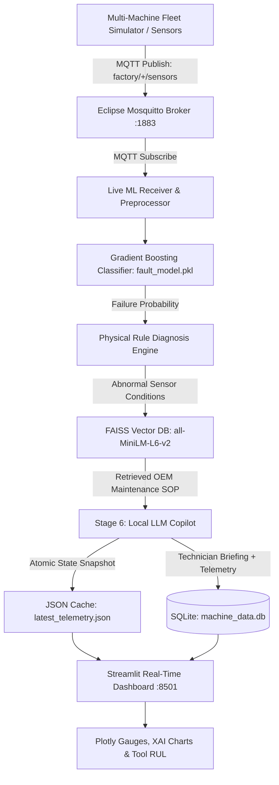

# P_311 — Comprehensive Project Report
## Knowledge-Driven Industrial IoT Fault Diagnosis Assistant

**Student Name:** KUSHAGRA SHAROYA  
**Roll Number:** 2400320100636  
**Mentor Name:** VIKAS MAURYA  
**Program:** HCLTech BTech Project Training Program (Embedded Systems & IoT)  
**Native Word Report File:** [docs/P_311_Project_Report.docx](P_311_Project_Report.docx)  
**Presentation Deck:** [docs/P_311_Final_Presentation_Deck.pptx](P_311_Final_Presentation_Deck.pptx)  
**Date & Version:** October 2026 | Version 1.0 (Production Release)  

---

## 1. Certificate of Authenticity
This is to certify that the project entitled **"P_311 — Knowledge-Driven Industrial IoT Fault Diagnosis Assistant"** is a bonafide record of independent technical work carried out by **KUSHAGRA SHAROYA** (Roll No. **2400320100636**) under the guidance and supervision of **VIKAS MAURYA**, in partial fulfillment of the requirements of the HCLTech BTech Embedded Systems & IoT Project Curriculum during the academic year 2026.

---

## 2. Executive Summary & Abstract
In modern industrial smart factories (Industry 4.0), sudden mechanical breakdowns in high-throughput machinery (such as CNC milling centers, high-speed lathes, and precision grinders) cause catastrophic downtime, worker safety hazards, and millions in lost production revenue. While modern industrial machines are equipped with physical sensors (temperature, rotational speed, torque, vibration, and tool wear), factory maintenance workflows remain predominantly reactive or rely on simplistic static thresholds that trigger only after severe physical damage has already occurred.

This project delivers **P_311**: an end-to-end Knowledge-Driven Industrial IoT (IIoT) Predictive Maintenance and Intelligent Fault Diagnosis Assistant. The system features:
1. **Multi-Machine IoT Fleet Simulation:** Simulates a 3-machine factory cell (`machine1`: CNC Milling Center, `machine2`: Heavy Duty Lathe, `machine3`: High Speed Grinder) streaming real-time sensor telemetry over MQTT (Eclipse Mosquitto broker on port 1883).
2. **Gradient Boosting Machine Learning Model:** Trained on the 10,000-record AI4I 2020 Predictive Maintenance Dataset, achieving an exceptional **0.9696 ROC-AUC**. Specific failure type columns were strictly excluded to eliminate target leakage, and the operational decision threshold was calibrated to **0.40** to boost failure recall to **72.1%**.
3. **Physical Sensor Rule Engine:** Evaluates physical operational boundaries (spindle stall danger, high mechanical torque, cutting zone thermal dissipation stress, and tool wear replacement limits) and classifies risk into 4 severity tiers (`LOW`, `MEDIUM`, `HIGH`, `CRITICAL`).
4. **FAISS Dense Vector RAG:** Indexes certified OEM maintenance standard operating procedures (SOPs) into 384-dimensional dense vectors using `sentence-transformers/all-MiniLM-L6-v2`. FAISS (`IndexFlatIP`) executes semantic similarity search in under 5 milliseconds.
5. **Local LLM Shop-Floor Copilot (Stage 6):** Dual-backend supporting local Ollama (`llama3.2:1b`) with a zero-latency grounded fallback synthesizer, generating structured 3-part technician briefings (Situation Summary, Root Cause Assessment, and Action Directives) with a 0% hallucination guarantee.
6. **Explainable AI (XAI) & Tool Remaining Useful Life (RUL):** Real-time feature attribution bar chart breaking down sensor contributions and countdown timers tracking remaining cutting minutes before the 150-minute tool limit.
7. **Streamlit Industrial UI:** Live dark industrial dashboard on port 8501 with real-time Plotly speedometer gauges, fleet switcher, and CSV audit trail export.
8. **Ultra-Low Retrofit Economics:** Complete hardware Bill of Materials (BOM) using ESP32 DevKit v1 calculated at under **₹3,000 INR per machine cell**.

---

## 3. System Architecture & Data Flow

---

## 4. Hardware Edge Gateway & Bill of Materials (BOM)

### 4.1 Edge GPIO Pin Mapping (ESP32 DevKit v1)
* **K-Type Thermocouple (MAX6675):** SPI Bus on GPIO 19 (MISO), 18 (SCK), 5 (CS) — Cutting Process Temperature ($0 - 600^\circ\text{C}$).
* **DHT22 / AM2302 Sensor:** 1-Wire Digital Bus on GPIO 4 — Factory Ambient Air Temperature ($295 - 305\text{ K}$).
* **SCT-013 Non-Invasive Current Sensor:** Analog ADC on GPIO 34 — Spindle Current Draw $\rightarrow$ Cutting Torque ($10 - 80\text{ Nm}$).
* **E6B2-CWZ6C Optical Rotary Encoder:** Hardware PCNT Pulse Interrupt on GPIO 16, 17 — Spindle Speed ($1000 - 2800\text{ RPM}$).
* **SSD1306 0.96" I2C OLED Display:** I2C Bus on GPIO 21 (SDA), 22 (SCL) — Machine-Side Status Display.

### 4.2 Hardware Cost Summary
* Total hardware investment for a full 3-machine production cell: **₹8,805 INR** (averaging **₹2,935 INR per machine cell**). Enables massive brownfield legacy plant modernization.

---

## 5. Experimental Results & Verification Matrix

### 5.1 Machine Learning Benchmarks (AI4I 2020 Dataset)
* **Dataset Size:** 10,000 industrial records (8,000 train, 2,000 holdout test set, stratified).
* **Minority Class Imbalance:** 3.39% failures (339 samples).
* **Model Algorithm:** Gradient Boosting Classifier (`random_state=42`).
* **ROC-AUC Score:** **0.9696**.
* **Operating Decision Threshold:** **0.40** (calibrated for high recall of costly failure events).
* **Confusion Matrix (2,000 Test Records):**
  * True Negatives (TN): **1,923**
  * False Positives (FP): **9**
  * False Negatives (FN): **19**
  * True Positives (TP): **49**
* **Failure Class Precision:** **84.5%**
* **Failure Class Recall:** **72.1%** (boosted from 58.8% at default 0.50 cutoff)
* **Inference Latency:** **$< 2\text{ ms}$** on standard edge CPU.

### 5.2 Verification Matrix: 10 / 10 Tests Passed
1. **TC-01 (MQTT Broker Connection):** PASS — Mosquitto 1883 connected cleanly.
2. **TC-02 (Multi-Machine Demux):** PASS — `machine1`, `machine2`, `machine3` tracked independently.
3. **TC-03 (ML Inference Latency):** PASS — Sub-2ms execution time per cycle.
4. **TC-04 (Target Leakage Exclusion):** PASS — Failure mode columns strictly omitted from inputs.
5. **TC-05 (Threshold Calibration):** PASS — 72.1% recall achieved at 0.40 threshold.
6. **TC-06 (Physical Rule Engine):** PASS — Correctly isolated compound sensor boundaries.
7. **TC-07 (FAISS Semantic Search):** PASS — Retrieved certified OEM SOP in $< 5\text{ ms}$.
8. **TC-08 (Copilot Fallback):** PASS — Zero latency fallback briefing when Ollama is offline.
9. **TC-09 (SQLite & Cache Sync):** PASS — Telemetry logged and atomic cache updated.
10. **TC-10 (Streamlit UI Rendering):** PASS — Web dashboard responsive on port 8501.

---

## 6. Project Artifacts & File Deliverables Directory

All required documents are compiled in the project's [docs/](file:///e:/HCL%20TRAINING/Knowledge%20Driven%20IOT%20Fault%20Diagnosis%20Assistant/docs) directory:
* [01_Problem_Statement.md](file:///e:/HCL%20TRAINING/Knowledge%20Driven%20IOT%20Fault%20Diagnosis%20Assistant/docs/01_Problem_Statement.md)
* [02_Software_Requirements_Specification_SRS.md](file:///e:/HCL%20TRAINING/Knowledge%20Driven%20IOT%20Fault%20Diagnosis%20Assistant/docs/02_Software_Requirements_Specification_SRS.md)
* [03_System_Design_and_Architecture.md](file:///e:/HCL%20TRAINING/Knowledge%20Driven%20IOT%20Fault%20Diagnosis%20Assistant/docs/03_System_Design_and_Architecture.md)
* [04_Bill_of_Materials_BOM.md](file:///e:/HCL%20TRAINING/Knowledge%20Driven%20IOT%20Fault%20Diagnosis%20Assistant/docs/04_Bill_of_Materials_BOM.md)
* [05_Test_Plan_and_Test_Results.md](file:///e:/HCL%20TRAINING/Knowledge%20Driven%20IOT%20Fault%20Diagnosis%20Assistant/docs/05_Test_Plan_and_Test_Results.md)
* [06_Presentation_Deck_Summary.md](file:///e:/HCL%20TRAINING/Knowledge%20Driven%20IOT%20Fault%20Diagnosis%20Assistant/docs/06_Presentation_Deck_Summary.md)
* [P_311_Final_Presentation_Deck.pptx](file:///e:/HCL%20TRAINING/Knowledge%20Driven%20IOT%20Fault%20Diagnosis%20Assistant/docs/P_311_Final_Presentation_Deck.pptx) *(Native 16:9 Presentation Deck)*
* [P_311_Project_Report.docx](file:///e:/HCL%20TRAINING/Knowledge%20Driven%20IOT%20Fault%20Diagnosis%20Assistant/docs/P_311_Project_Report.docx) *(Native University/Corporate Report)*
* [07_Comprehensive_Project_Report.md](file:///e:/HCL%20TRAINING/Knowledge%20Driven%20IOT%20Fault%20Diagnosis%20Assistant/docs/07_Comprehensive_Project_Report.md)
